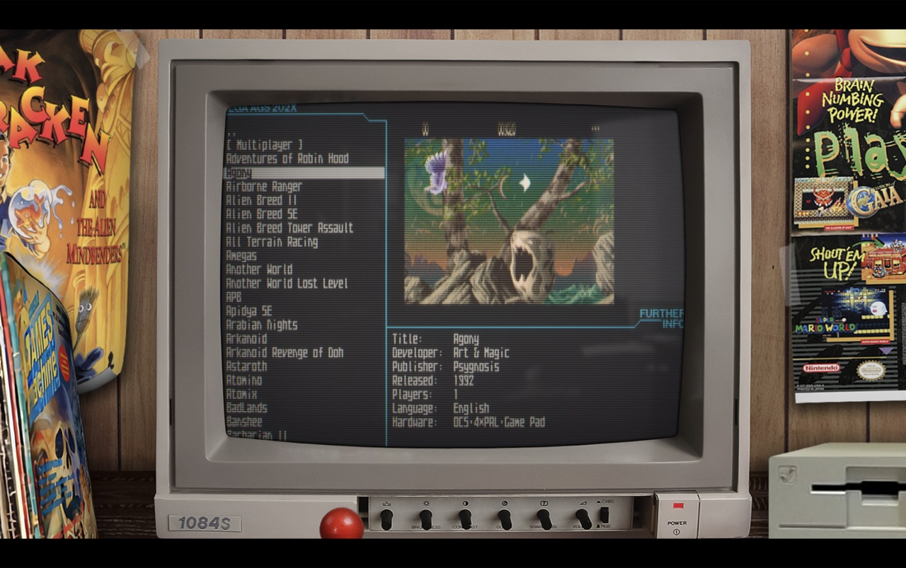
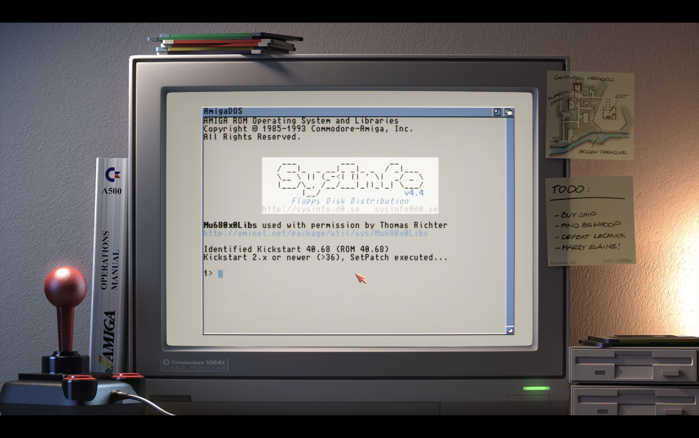

# Amiberry

[](https://github.com/BlitterStudio/amiberry/actions/workflows/c-cpp.yml)
[](https://nightly.link/BlitterStudio/amiberry/workflows/c-cpp.yml/master)
[](https://discord.gg/wWndKTGpGV)
[](https://ko-fi.com/X8X4FHDY4)

**Optimized Amiga emulator for Linux, macOS, Windows, Android, FreeBSD, and Haiku.**

Built on the WinUAE emulation core, Amiberry delivers full Amiga compatibility on 64-bit hosts, including aarch64, x86_64, RISC-V and LoongArch64 hardware — from a Raspberry Pi to a desktop workstation. Custom JIT compilation for aarch64 and x86_64 provides maximum emulation speed. 32-bit host builds are not supported; emulated Amiga CPU and address widths are unchanged.

## Sponsors

A huge thank you to the companies and individuals who support Amiberry development.

### Certified Partners

[](https://ko-fi.com/midwan)

### Partners

[](https://ko-fi.com/midwan)

### Supporters

[](https://ko-fi.com/midwan)

> **[View full sponsor details on amiberry.com](https://amiberry.com#sponsors)**

---

## Commercial Use & Sponsorship

Amiberry is free and open source under the [GPL v3 license](LICENSE).
You are welcome to use, modify, and redistribute it under those terms.

**If you are shipping a commercial product, paid subscription service, or
hardware bundle that includes Amiberry**, we ask that you support the project
financially. Amiberry is maintained by a single developer — the features and
platforms your product depends on exist because of community and corporate support.

### Corporate Sponsorship Tiers

| Tier | Monthly | Benefits |
|------|---------|----------|
| 🥉 Supporter | €50/mo | Named on website, listed in release notes |
| 🥈 Partner | €150/mo | Logo on website + README, early release access, priority issue responses |
| 🥇 Certified Partner | €300/mo | Everything above + "Amiberry Certified Partner" badge for your product/marketing |

👉 [Become a corporate sponsor on Ko-Fi](https://ko-fi.com/midwan)
📧 For custom arrangements, contact: **midwan@gmail.com**

*Individual supporters keep this project alive too —
[any contribution is appreciated](https://ko-fi.com/midwan).*

> **[Visit amiberry.com](https://amiberry.com)** for the full documentation site.




## Features

- **JIT Compiler** — Custom just-in-time compilation for aarch64 and x86-64
- **WHDLoad Support** — Launch WHDLoad titles directly with automatic configuration
- **Custom Bezels & Shaders** — CRT monitor frames, overlay effects, and GLSL shader support
- **Modern GUI** — Clean Dear ImGui interface navigable by mouse or gamepad
- **Drag & Drop** — Drop floppy images, hard files, and config files directly into the emulator
- **Auto-Update** — Built-in update checker with SHA256-verified downloads
- **RetroArch Ready** — Seamless controller mapping for RetroArch setups

## Quick Install

### Linux

```bash
curl -fsSL https://packages.amiberry.com/install.sh | sudo sh
sudo apt install amiberry
```

Also available via [PPA](https://launchpad.net/~midwan-a/+archive/ubuntu/amiberry) · [COPR](https://copr.fedorainfracloud.org/coprs/midwan/amiberry/) · [Flatpak](https://flathub.org/apps/com.blitterstudio.amiberry) · [AUR](https://aur.archlinux.org/packages/amiberry) · [.deb/.rpm](https://github.com/BlitterStudio/amiberry/releases/latest).

**AppImage (no installation):** each release includes `Amiberry-<version>-x86_64.AppImage` for Intel/AMD and `Amiberry-<version>-aarch64.AppImage` for 64-bit ARM. Download the one for your CPU from [Releases](https://github.com/BlitterStudio/amiberry/releases/latest), then:

```bash
chmod +x Amiberry-<version>-x86_64.AppImage
./Amiberry-<version>-x86_64.AppImage
```

The AppImage needs glibc 2.35 or newer (Ubuntu 22.04 or later). See the [AppImage guide](https://amiberry.com/linux-packages#appimage) for running without FUSE, keeping data beside the image, and updates.

### macOS

```bash
brew install --cask amiberry
```

### Windows

Download the [installer or portable ZIP](https://github.com/BlitterStudio/amiberry/releases/latest).  x64 and ARM64 (Windows-on-ARM / Snapdragon X, Copilot+) builds are both published.  The portable ZIP includes the `amiberry.portable` marker, so writable paths stay next to `Amiberry.exe` without extra setup.

> **Windows ARM64 in a VM (VMware Fusion / Parallels / Hyper-V):** the guest usually has no OpenGL ICD installed, so Amiberry's GL init fails at startup.  Drop Mesa3D's `opengl32.dll` (`mesa-llvmpipe-arm64` from [mmozeiko/build-mesa](https://github.com/mmozeiko/build-mesa/releases)) next to `Amiberry.exe` — that gives you software OpenGL 3.3+ and the GUI comes up.  Native WoA hardware doesn't need this workaround.

### Android

Currently in Closed Testing on [Google Play](https://play.google.com/store/apps/details?id=com.blitterstudio.amiberry) for [Ko-fi](https://ko-fi.com/midwan) members, who receive a 100% discount code that also covers the final release. Open Testing is planned after the next release, followed by a public paid release on Google Play. AArch64 & x86_64, with full aarch64 JIT support. See the [Android wiki page](https://github.com/BlitterStudio/amiberry/wiki/Android) for details.

### FreeBSD
Install from the FreeBSD package repository:

```bash
pkg install amiberry
```

Each Amiberry release also ships packages for FreeBSD 14 and 15 (amd64 and aarch64) on the [releases page](https://github.com/BlitterStudio/amiberry/releases/latest), which can be newer than the ports tree. Download the one matching your FreeBSD version and CPU, then install it with `pkg install`, which fetches the dependencies from your configured repository:

```bash
pkg install ./amiberry-v8.5.0-freebsd15-amd64.pkg
```

These packages are built against the `quarterly` package branch, which is the default on FreeBSD. If your system uses `latest`, a dependency may have moved to a newer library version; use the ports package in that case.

Or if you prefer to install from Source then

```bash
git clone --depth 1 https://github.com/freebsd/freebsd-ports /usr/ports
cd /usr/ports/emulators/amiberry
make install
```

### Haiku

Each release ships a Haiku (R1/beta) package for 64-bit x86 on the [releases page](https://github.com/BlitterStudio/amiberry/releases/latest). Download the `.hpkg` and install it with `pkgman`, which pulls the dependencies in from HaikuPorts, or just double-click the downloaded file:

```bash
pkgman install ./amiberry-v8.5.0-haiku-x86_64.hpkg
```

The package installs the binary into `/boot/system/bin`, its data into `/boot/system/data/amiberry`, and a Deskbar entry under Applications. All dependencies (SDL3, FFmpeg, and friends) come from HaikuPorts; there is no Amiberry recipe in HaikuPorts, so the release package is the only supported way to install it.

## Code Signing

Release binaries are signed through SignPath. See the [Code signing policy](https://amiberry.com/code-signing-policy) for signing scope, release approval roles, and privacy notes.

## Documentation

- **[Getting Started](https://github.com/BlitterStudio/amiberry/wiki/Quick-start-guide)** — Quick start guide
- **[Full Wiki](https://github.com/BlitterStudio/amiberry/wiki)** — Complete documentation
- **[Build from Source](https://github.com/BlitterStudio/amiberry/wiki/Compile-from-source)** — Compile for your platform
- **[Troubleshooting](https://github.com/BlitterStudio/amiberry/wiki/Troubleshooting)** — Common issues and solutions

## Building from Source

```bash
cmake -B build -DCMAKE_BUILD_TYPE=Release
cmake --build build -j$(nproc)
```

See the [build guide](https://github.com/BlitterStudio/amiberry/wiki/Compile-from-source) for platform-specific instructions, dependencies, and build options.

Desktop builds enable SDL3-backed genlock video and camera input by default (`USE_VIDEOGRAB`). `USE_FFMPEG` independently enables ZZ9000 and genlock media decoding when FFmpeg 5.1 or newer development files are available; it requires libavformat 59.27+, libavcodec 59.37+, libavutil 57.28+, libswresample 4.7+, and libswscale 6.7+. `USE_WEBP` enables still and animated WebP decoding when libwebp and libwebpdemux development files are available.

### Emulator regression checks

ROM-free regression fixtures compile production functions to check CPU flags
and exception frames, coherent CIA timer reads, event dispatch, 68030 ATC and
locked accesses, queued sprite writes, AGA subpixel collisions, and writable
RTC counters, calendar, hour modes and sub-frame carry/BUSY timing.
The x86 flag-emitter check runs only on x86-64 hosts.

Run `bash tests/test_frame_pacing.sh` for software frame-pacing checks, including
adaptive scheduler-overshoot margins and PAL/NTSC deadline boundaries.

The RTC counts emulated time (chipset cycles), like the real chip's own
crystal next to the colour clock: its seconds agree with the CIAs and the beam
also when the emulation runs slower or faster than real time, and host frame
waits cannot hide the MSM6242B's 244-microsecond BUSY pulse from a polling
guest. It starts at the host clock and re-anchors to it on reset, state
restore, pause/resume and warp transitions; warp retains a wall-clock RTC.
While running it slews towards the host clock by at most 1 % once they are more
than a second apart, and re-anchors after a host clock jump of over an hour.
MSM6242B HOLD freezes the calendar during writes and defers one carry until
release; Ricoh calendar and leap counters advance regardless of the selected
register bank.
Savestates capture the RTC at the save instant. An RTC file preserves
guest-written calendars and independent weekday/leap counters across restarts;
only running clocks advance while the emulator is off, and HOLD defers one carry.

FPU exception, stack-frame and compiler checks run with
`python3 tests/fpu_exception_regressions_test.py`,
`python3 tests/fpu_frame_regressions_test.py` and
`python3 tests/fpu_jit_compiler_regressions_test.py`.
These include independent FPSR condition-bit combinations in interpreted and
compiled x86 predicates, with signaling conditions retaining BSUN handling.
Run `python3 tests/fpu_predicates_live_test.py build/amiberry` to execute an
original synthetic ROM's predicate matrix and integer-CCR preservation checks
through both the interpreter and JIT, without external ROMs or disks.

Interpreter handlers and x86 JIT translators are checked in. After changing
`src/gencpu.cpp` or `src/jit/x86_64/gencomp.cpp`, regenerate their outputs;
CMake does not run these generators automatically.

## Contributing

Contributions are welcome — bug reports, feature suggestions, and pull requests all help make Amiberry better.

1. Fork the repository
2. Create your feature branch: `git checkout -b feature/my-feature`
3. Commit your changes: `git commit -m 'Add my feature'`
4. Push to the branch: `git push origin feature/my-feature`
5. Open a Pull Request

## Community

[](https://discord.gg/wWndKTGpGV)
[](https://mastodon.social/@midwan)
[](https://ko-fi.com/X8X4FHDY4)

## License

Amiberry is licensed under the [GNU General Public License v3.0](LICENSE).

---

Supported by [JetBrains](https://jb.gg/OpenSourceSupport).
